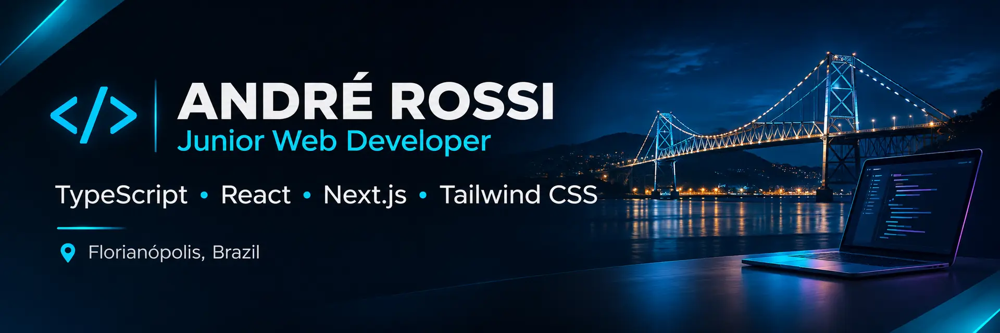

 

### 👋 Hi! I'm André Rossi

Junior Web Developer focused on **React, Next.js, TypeScript and Tailwind CSS**, building practical software projects and modern web interfaces.

---

## 👨‍💻 About Me

I'm a Software Development graduate based in Florianópolis, Brazil, pursuing a career in **Front-end and Full Stack Web Development**.

I'm developing responsive web projects with **React, Next.js, TypeScript and Tailwind CSS**, while continuing to strengthen my JavaScript and Node.js skills. I also built **ROSSI Pitwall**, a desktop telemetry application for F1 25 that gave me hands-on experience with real-time UDP data, Electron, typed architecture, testing and documentation.

- 💻 Focused on **Front-end / Full Stack Development**
- 🛠️ Learning by building, testing and improving real projects
- 🎯 Looking for an opportunity as a **Junior Developer**
- 🌎 Advanced English
- 📍 Florianópolis, SC — Brazil

---

## 🎯 Current Focus

---

## 🛠️ Tech Stack

### Web Development

### Other Experience

### Desktop & Development Tools

---

## 🚀 Featured Projects

### 🏎️ ROSSI Pitwall — F1 25 Telemetry Monitor

A local Windows desktop application that reads **F1 25 UDP telemetry (2025 and 2026 formats)** and displays speed, gear, lap, session context, tyres, fuel, ERS, race position and time gaps.

Built with **Electron, React, TypeScript and Node.js**, with a separate simulation mode and automated tests.

**Status:** Technical Preview V0.3C-A — active development paused. No Windows installer is available.

---

### 📘 TypeScript Fundamentals

Repository documenting my TypeScript learning journey through practical examples and exercises organized by topic and lesson.

**Topics covered:**

Type System • Union Types • Narrowing • Interfaces • Generics • Utility Types • Type Guards • Git Workflow

---

## 📫 Let's Connect

---

### Building, learning and improving one project at a time. 🚀

